<div align="center">

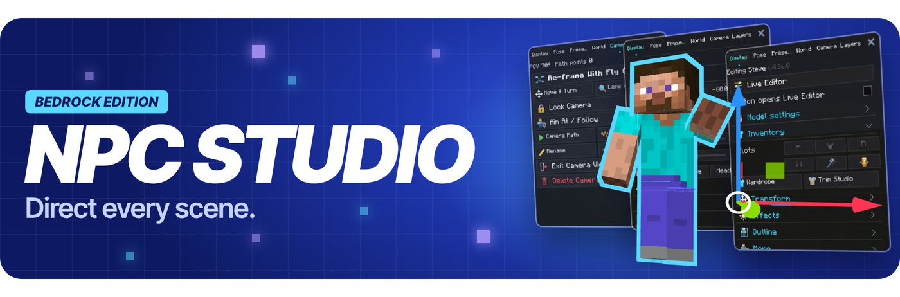

<br>

<a href="https://discord.gg/UGSPAUBUvF">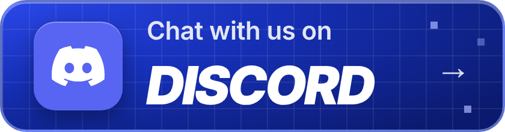</a>&nbsp;
<a href="https://noxeelmc-art.github.io/npc-studio-skins/">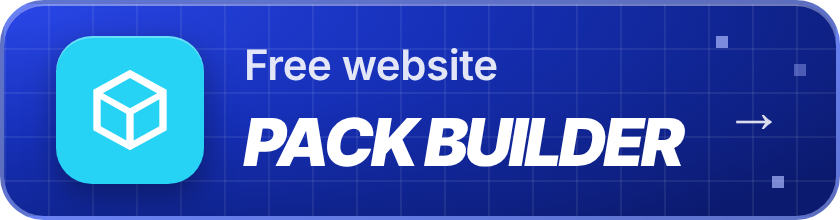</a>&nbsp;
<a href="https://youtube.com/@NoxeelMC"></a>

<br><br>

[](https://www.curseforge.com/projects/1650549)
[](https://www.curseforge.com/projects/1650549)
[](#install)
[](#install)
[](#install)
[](LICENSE)

## Pose, dress and film NPCs and mobs like a real studio.

**The Bedrock toolkit for thumbnails and cinematics.** Pose every limb with a gizmo, film with real cameras,<br>
turn NPCs into 29 Minecraft mobs, and share whole scenes as a code. No experiments, made for phones.

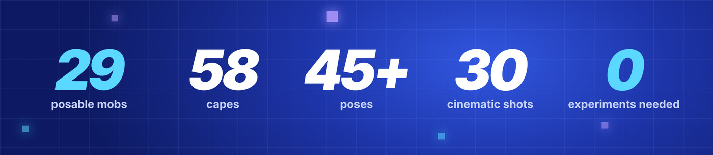

[Features](#features) · [Install](#install) · [Build it yourself](#build-it-yourself) · [How it works](#how-it-works) · [Contributing](#contributing) · [License](#license)

</div>

---

<a id="features"></a>

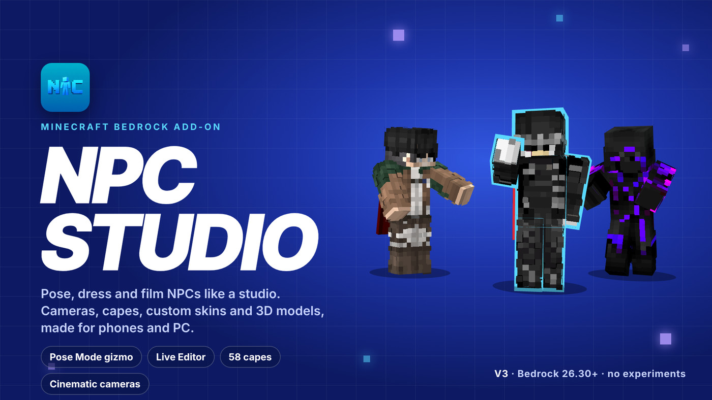

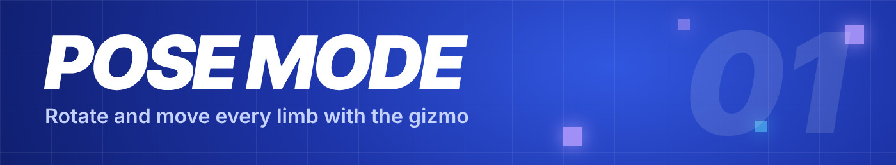

Look at a body part and **rotate or move it** with the red, green and blue gizmo. Walk around while you pose, so you can check it from every side. **45+ ready poses**, **19 looping animations**, undo, redo and mirror.

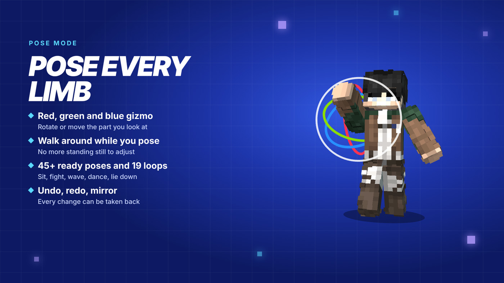

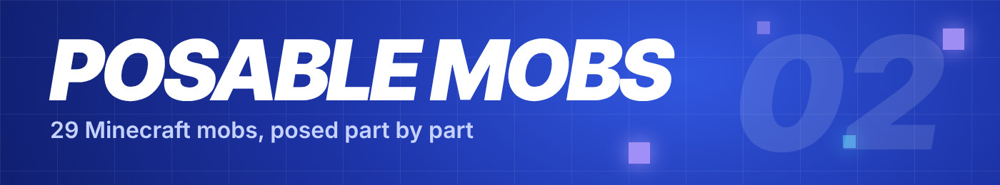

**29 Minecraft mobs** with their real models and textures: zombie, warden, horse, creeper, wolf, spider, piglin and more. Legs, wings, head and body all move with the same gizmo, and presets, animations and the Live Editor work on them too. Turn any NPC into a mob in **Display → Mob**.

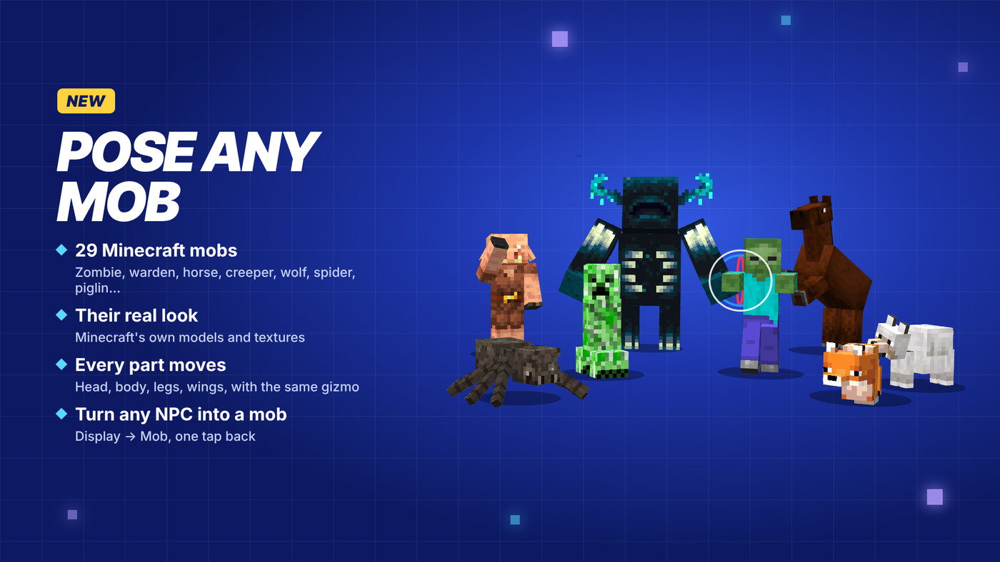

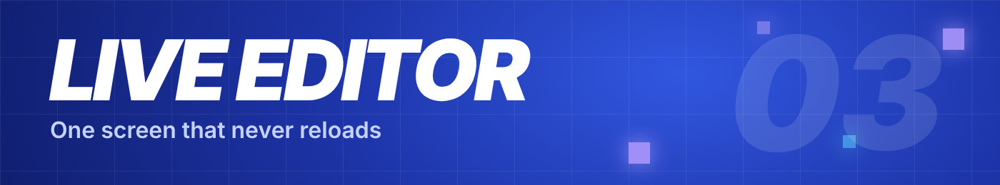

The **Studio panel** docks on the left with six tabs: Display, Pose, Presets, World, Camera, Layers. The **Live Editor** is one screen that never reloads: every toggle, slider and list changes the NPC the moment you touch it.

| | |
|---|---|
| **Display** | skin, mob, 3D model, cloak, nametag, sneak, living, animation, rotation, scale, look at me, flip, on fire, bright |
| **Inventory** | six slots, exact copies of your gear, Trim Studio, enchant glint, Item State, **Hold poses** for any item (even guns from other add-ons) |
| **World** | time, weather, gamerules, world bright, depth fog |
| **Layers** | hide NPCs, cameras, outlines or name tags for clean shots |
| **Quick** | **Come To Me** and **Look Where I Look**, always at the top |

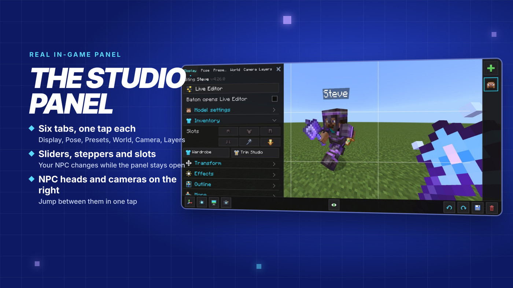

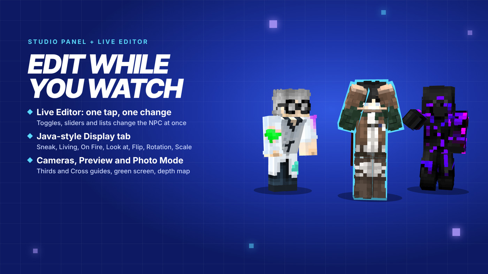

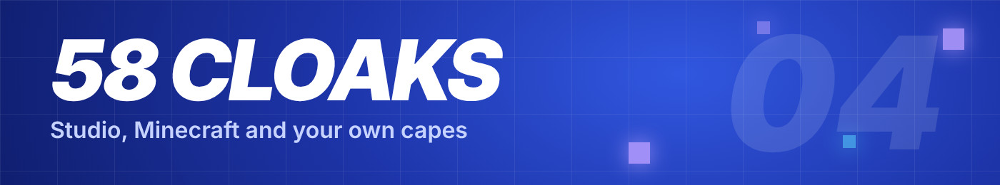

8 studio capes, 43 Minecraft capes and 7 slots for your own, picked from pictures in **Display → Cloak**.

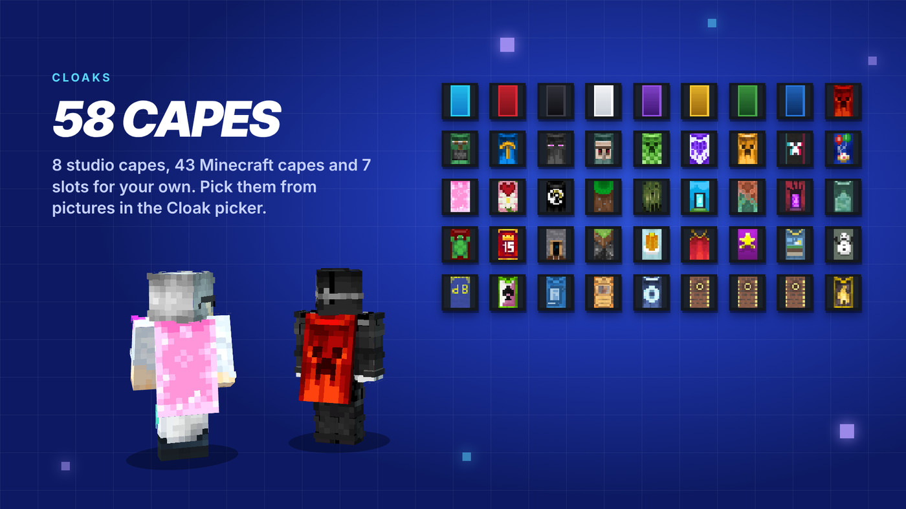


The free **[Pack Builder](https://noxeelmc-art.github.io/npc-studio-skins/)** runs on your phone or PC: get a player's skin by name, add capes and Blockbench 3D models, preview them in 3D and download one small pack. Nothing is uploaded, the pack is built in your browser.

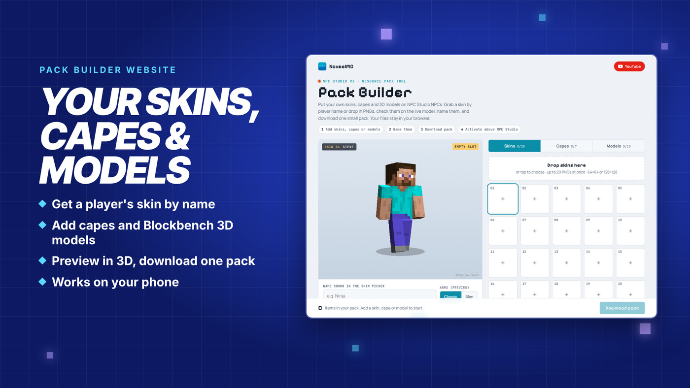

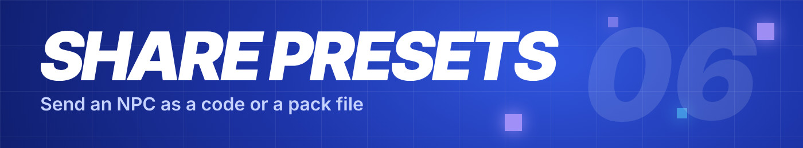

Save an NPC as a preset and send it as a **code** (Presets → Share Code). Your friend taps Import Code and pastes it. Or turn codes into a **preset pack** on the website. PC players can share exact copies as `.mcstructure` files.

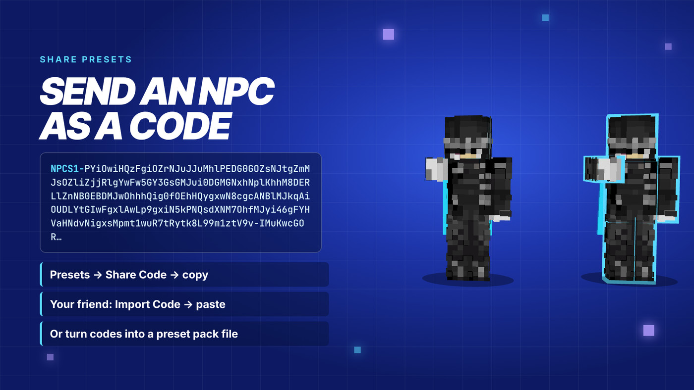

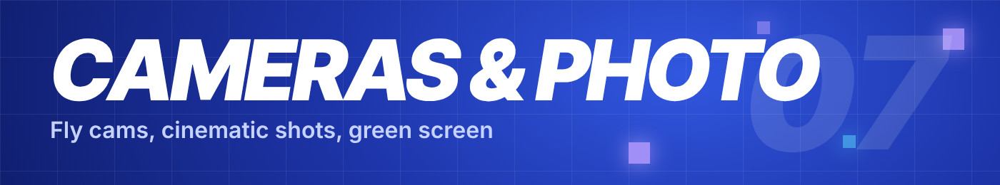

Pyramid cameras that show the real shot, **Fly Cam**, **30 cinematic shots**, Thirds and Cross guides, Photo Mode, green screen and a depth map.

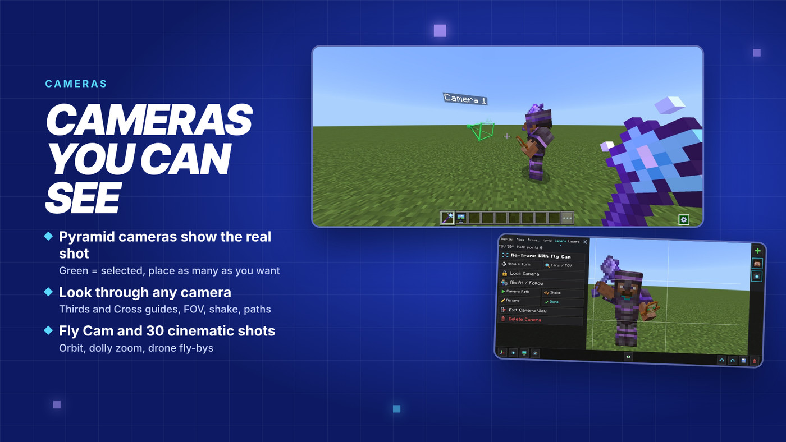

### Made in NPC Studio

<table>
<tr>
<td width="50%">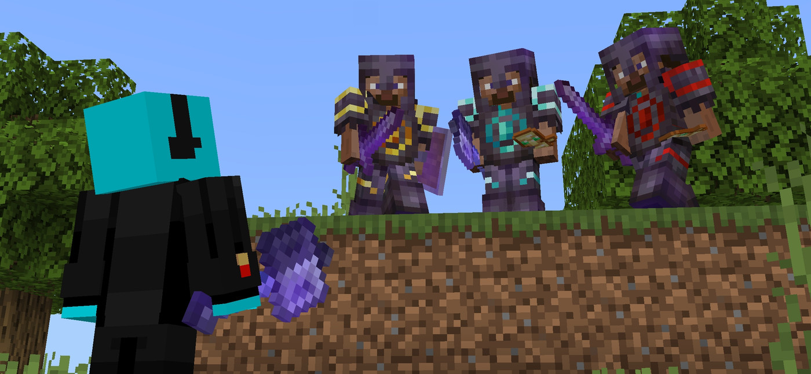</td>
<td width="50%">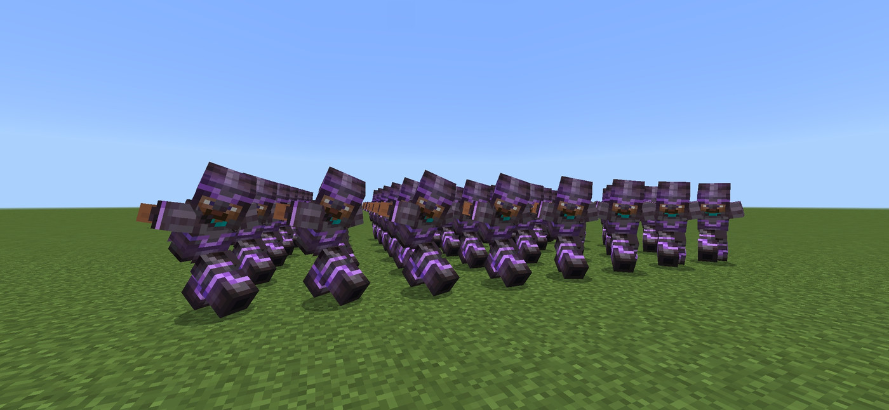</td>
</tr>
<tr>
<td align="center"><sub>Wardrobe + Trim Studio</sub></td>
<td align="center"><sub>Make A Crowd</sub></td>
</tr>
</table>

---

<a id="install"></a>

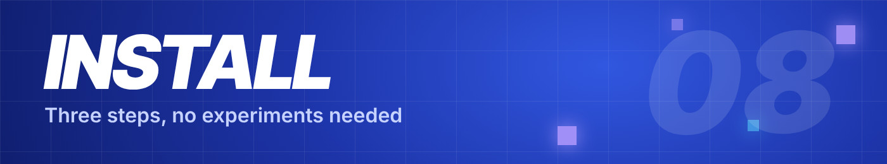

1. Download the **`.mcaddon`** from [CurseForge](https://www.curseforge.com/projects/1650549) and open it. Minecraft imports both packs.
2. Create a world (or edit one) and turn on **NPC Studio** in Behavior Packs. The resource pack comes with it.
3. In game, use the **Director's Baton** from your hotbar: tap an NPC to edit it, or open the panel to spawn one.

> [!TIP]
> Updating? Delete the old NPC Studio packs first, then make a new world. The version shows at the top of the panel.

<a id="build-it-yourself"></a>

## 🛠️ Build it yourself

You need **Python 3** and **Pillow** (`pip install pillow`).

```bash
git clone https://github.com/noxeelmc-art/npc-studio
cd npc-studio
python3 tools/build.py        # → dist/NPC Studio V3.mcaddon
```

`BP/` and `RP/` work as they are: copy them into Minecraft's `development_behavior_packs` and `development_resource_packs` folders to edit live.

<details>
<summary><b>Regenerating the generated files</b></summary>

<br>

Many files in `BP/` and `RP/` are made by tools. If you change a tool, run them in this order (each one edits the output of the one before):

| Step | Tool | Makes |
|:-:|---|---|
| 1 | `tools/make_models.py` | player, outline and cape models |
| 2 | `tools/make_gizmo.py` | the Pose Mode gizmo |
| 3 | `tools/make_custom.py` | custom skin / cape / model slots, capes, view boxes |
| 4 | `tools/make_mobs.py` | posable mobs (`--src <bedrock-samples>/resource_pack` re-reads Minecraft's models) |
| 5 | `tools/make_ui.py` | the Studio panel (`RP/ui/server_form.json`) and its textures |
| 6 | `tools/build.py` | the `.mcaddon` |

Also: `make_icons.py` / `make_assets.py` (icons and textures), `make_depth_pack.py` (the optional Depth Map pack), `skin-pack-builder.html` + `make_site.py` (the Pack Builder website).

</details>

<a id="how-it-works"></a>

<details>
<summary><b>How it works</b></summary>

<br>

| Where | What |
|---|---|
| `BP/scripts/main.js` | events and tools; everything starts here |
| `BP/scripts/panel.js`, `core.js` | the Studio panel: menus are ActionForms tagged with invisible colour codes that `RP/ui/server_form.json` draws as the docked panel |
| `BP/scripts/liveform.js` | the Live Editor (CustomForm + Observables, no reload) |
| `BP/scripts/rig.js`, `poseEditor.js` | pose properties, undo, the Pose Mode gizmo |
| `BP/scripts/skins.js`, `mobdata.js` | skins, custom models and posable mobs (`skin_index`) |
| `BP/scripts/camera.js`, `cinema.js`, `shots.js`, `studio.js` | cameras, Fly Cam, cinematic shots, Photo Mode, layers |
| `BP/scripts/wardrobe.js`, `itemstate.js` | gear, trims, Item State and Hold poses |
| `BP/scripts/share.js` | preset codes and preset packs |
| `BP/entities/npc_studio.json` | the NPC entity: 32 properties drive pose, skin, cape and flags |

</details>

<a id="contributing"></a>

## 🤝 Contributing

Bug reports, ideas and pull requests are welcome: open an [issue](../../issues) or come say hi on [Discord](https://discord.gg/UGSPAUBUvF). NPC Studio is touch first, so please test panel changes on a phone.

<a id="license"></a>

## 📜 License

The code is **[GPL-3.0-or-later](LICENSE)**: use it, learn from it, change it and share it. Changed versions must stay open source, keep the credit to NoxeelMC, and use **their own name and logo**. Minecraft's models, textures and capes are not covered by the GPL. Details and credits: **[NOTICE.md](NOTICE.md)**.

---

<div align="center">

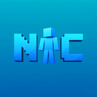

**Made by [NoxeelMC](https://youtube.com/@NoxeelMC)**

<sub>Inspired by the NPC Studio mod for Minecraft Java Edition · Not affiliated with Mojang or Microsoft</sub>

</div>
